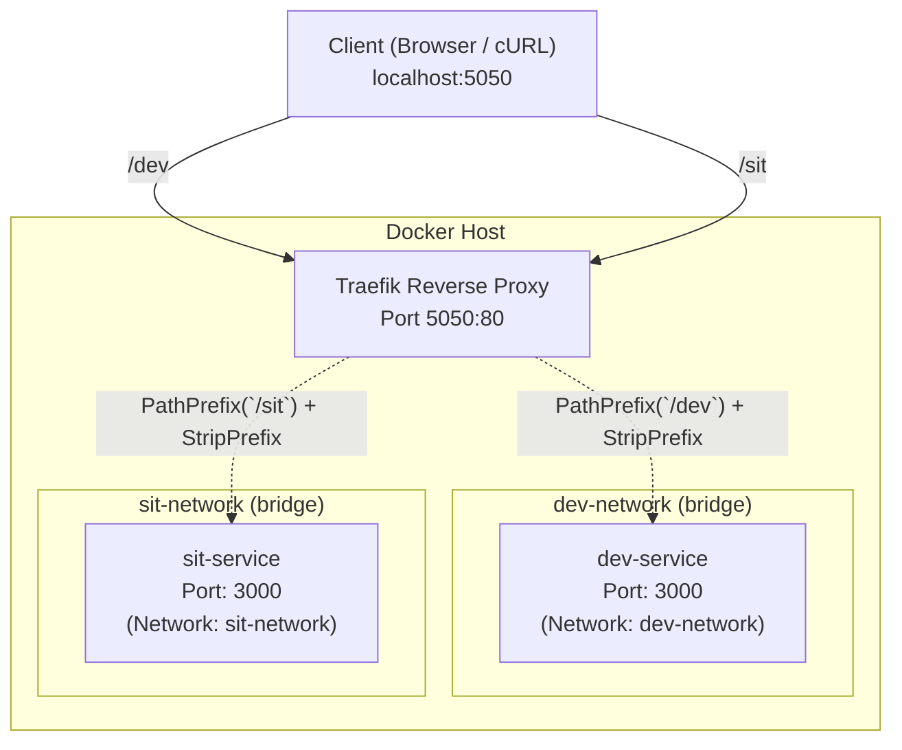

# Docker Traefik Multi-Environment Reverse Proxy Setup

This project demonstrates how to use **Traefik** as a reverse proxy to route traffic to two isolated environments (**DEV** and **SIT**) running on the **same internal port (`3000`)** across dedicated Docker bridge networks.

---

## Architecture Overview



### Key Highlights
1. **Isolated Networks**: `dev-network` and `sit-network` are completely separated. Containers in `dev-network` cannot reach containers in `sit-network`.
2. **Identical Internal Ports**: Both `dev-service` and `sit-service` listen internally on port `3000`. No port conflicts occur because they are isolated containers on separate bridge networks.
3. **Traefik Routing & Middleware**:
   - `http://localhost:5050/dev` ➔ routes to `dev-service:3000`
   - `http://localhost:5050/sit` ➔ routes to `sit-service:3000`
   - `StripPrefix` middleware strips `/dev` and `/sit` before handing off requests to the Node.js apps, allowing standard root routing (`/`) in application code.

---

## Directory Structure

```text
d:/Docker-proxy/
├── dev/
│   ├── Dockerfile
│   ├── package.json
│   └── server.js
├── sit/
│   ├── Dockerfile
│   ├── package.json
│   └── server.js
├── docker-compose.yml
└── README.md
```

---

## How to Run

### Start the Services
```powershell
docker compose up -d --build
```

### Test DEV Environment
```powershell
curl.exe http://localhost:5050/dev
```
Expected output:
```json
{
  "status": "success",
  "environment": "DEV",
  "message": "Hello from DEV environment!",
  "port": 3000,
  "containerHost": "...",
  "url": "/",
  "clientIp": "172.18.0.1",
  "timestamp": "..."
}
```

### Test SIT Environment
```powershell
curl.exe http://localhost:5050/sit
```
Expected output:
```json
{
  "status": "success",
  "environment": "SIT",
  "message": "Hello from SIT environment!",
  "port": 3000,
  "containerHost": "...",
  "url": "/",
  "clientIp": "172.18.0.1",
  "timestamp": "..."
}
```

### View Web Interface in Browser
- Open `http://localhost:5050/dev` in your browser for the Dev dashboard.
- Open `http://localhost:5050/sit` in your browser for the SIT dashboard.
- Open `http://localhost:8080/dashboard/` to view the Traefik management dashboard.

### Verify Network Isolation
Test that `dev-service` cannot reach `sit-service`:
```powershell
docker exec dev-service wget -T 2 -qO- http://sit-service:3000
# Output: wget: bad address 'sit-service:3000' (isolated!)
```

### Stop the Services
```powershell
docker compose down
```
